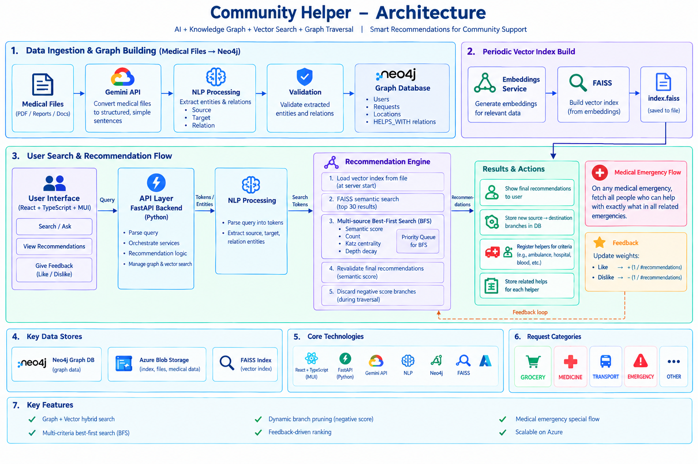

# Community Helper

**AI-powered community support recommendations using NLP, a Neo4j knowledge graph, semantic vector search, and graph traversal.**

Community Helper is designed to connect people requesting help with relevant community members and resources. It combines structured relationship extraction from medical documents with vector retrieval and graph-based recommendation ranking.

## Architecture



### End-to-end workflow

1. **Document ingestion:** Medical files are processed with the Gemini API to convert their content into simpler, structured sentences.
2. **Relationship extraction:** NLP extracts source entities, target entities, and relationships from the structured text.
3. **Validation and graph storage:** Extracted relationships are validated and stored in Neo4j.
4. **Periodic vector indexing:** A separate service builds an embedding-based FAISS index and persists it to a file.
5. **Query processing:** A user submits a query through the React + TypeScript UI. The FastAPI backend processes the query and NLP tokenization is used to prepare the search.
6. **Candidate retrieval:** FAISS semantic search retrieves an initial set of up to 30 candidates.
7. **Graph-based recommendation:** A priority-queue-guided, best-first traversal explores promising connected paths using multiple signals:
   - Semantic similarity
   - Relationship or occurrence count
   - Katz centrality
   - Depth decay
8. **Recommendation validation:** Candidate recommendations are rechecked for semantic relevance before being returned. Negative-scoring branches are pruned during traversal.
9. **Community support actions:** The system can register helpers for relevant criteria, store related help relationships, and persist newly discovered source-to-destination branches.
10. **Feedback loop:** User likes and dislikes adjust recommendation weights. In the current described approach, a positive response adds `1 / number_of_recommendations` and a negative response subtracts the same amount.
11. **Emergency support:** For medical emergencies, the system aims to find people who can help with the specific need across related emergency scenarios.

## Core capabilities

- Hybrid semantic retrieval and knowledge-graph exploration
- NLP-based source, target, and relationship extraction
- Multi-signal graph recommendation ranking
- Priority-queue-guided best-first traversal
- Negative-score branch pruning
- Feedback-informed recommendation weights
- Helper discovery for community needs and medical emergencies
- Persistence of graph relationships and vector index

## Technology stack

| Component | Technology |
|---|---|
| Frontend | React, TypeScript, Material UI |
| API/backend | FastAPI, Python |
| LLM-assisted document structuring | Gemini API |
| Entity and relationship extraction | NLP pipeline |
| Graph database | Neo4j |
| Embedding similarity search | FAISS |
| Vector index persistence | Local file; Azure Blob Storage has also been discussed |
| Deployment | Azure services, depending on the active environment |

## Request categories

The application includes the following request categories:

- `GROCERY`
- `MEDICINE`
- `TRANSPORT`
- `EMERGENCY`
- `OTHER`

## Repository layout

The backend is located in `backend/`. Update this section to match the repository's current folders and entry points.

```text
.
├── backend/
├── Architecture_Diagram.png
└── README.md
```

## Setup

Setup commands depend on the current project configuration. Check the backend dependency file and frontend package manifest for the exact commands and environment variables.

Typical steps:

1. Clone the repository.
2. Install backend dependencies from the project's dependency file.
3. Install frontend dependencies using the package manager specified by the frontend project.
4. Configure required environment variables for Gemini, Neo4j, embeddings/vector storage, and any enabled cloud services.
5. **Start the backend:**
   ```bash
   cd backend
   python -m uvicorn app.main:app --reload
   ```
6. **Start the frontend:**
   ```bash
   npm start
   ```

**Security:** Keep API keys, database credentials, storage connection strings, and other secrets in environment variables or a secrets manager. Never commit them to Git.

## Notes

- The FAISS index is described as being built periodically by a separate service and loaded by the backend at startup. Confirm the refresh/reload mechanism in the deployed environment.
- A priority queue supports best-first traversal; this is not identical to a conventional level-order BFS. The implementation may combine traversal strategies.
- Medical information and recommendations should be treated as support for connecting people, not as a substitute for professional medical advice or emergency services.
- Update deployment and setup details to reflect the components that are currently enabled in the repository.
